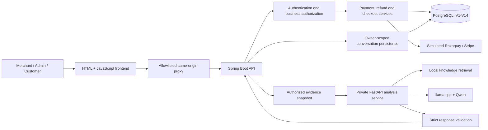

# PayMesh AI

### Payment orchestration with evidence-grounded AI

PayMesh AI is a full-stack portfolio project built around a **Java payment backend** and a **private Python AI service**. Merchants can manage simulated payments, refunds and payment links; customers can open a checkout without signing in; administrators can manage merchant access and monitor activity. An AI assistant explains recorded outcomes using authorized financial evidence and local knowledge retrieval.

**All gateways are simulated. This project does not move real money or collect real payment credentials.**

Built to demonstrate Java backend architecture, transaction safety, Spring Security, PostgreSQL concurrency and practical GenAI integration on modest local hardware.

[Architecture](#architecture) · [Features](#implemented-features) · [Workflows](#user-workflows) · [AI design](#ai-investigation-and-conversations) · [Setup](#local-development) · [Testing](#testing-and-verification) · [Docker](#docker-and-github-actions) · [Documentation](#documentation)

## The problem

A payment timeout does not necessarily mean failure. Retried requests can create duplicate operations, refunds need complete history, and support teams need to explain what happened without guessing about bank settlement.

PayMesh brings those concerns into one application: explicit payment states, database-backed idempotency, merchant ownership checks, retained gateway/refund history and explanations grounded in the records the current user is allowed to access.

## Implemented features

| Area | Capabilities |
| --- | --- |
| Merchant portal | Signup and approval workflow, dashboard, payment/refund monitoring, business profile and account security |
| Payments | Explicit creation/processing, simulated currency routing, gateway history, signed webhook handling and reconciliation |
| Refunds | Partial/full refunds, exact remaining-amount checks and idempotent requests |
| Payment links | Create, list, filter, copy, inspect and cancel owned links; expiry, fixed amount/method and validated gateway selection |
| Public checkout | Token-scoped checkout, explicit simulated payment confirmation, durable attempts, status and safe receipt views |
| Admin portal | Merchant approval/rejection/suspension/reactivation, cross-merchant monitoring, audit history and admin profile |
| Analytics | Chart.js dashboards, UTC date filters, currency-separated amounts and accessible exact-value tables with five-row pagination |
| AI assistance | Structured payment investigation, Merchant/Admin assistants and payment-specific Ask AI |
| Conversations | Owner/role/context-scoped saved history, restoration, title search, pagination, rename and deletion |
| Sessions | Short-lived access tokens, persistent refresh sessions, Remember Me, logout-all and cross-tab account switching |

**Current status:** V1–V14 migrations and the application features above are implemented. The operator reports successful local activation, Qwen inference, Merchant/Admin browser E2E and payment-link/checkout/status testing. These local results do not establish production readiness or container E2E. Remote Docker build validation and Docker Hub publication remain pending verified success.

## Technology stack

| Layer | Technologies |
| --- | --- |
| Backend | Java 21, Spring Boot 3.5.7, Spring MVC, Spring Security, OAuth2 Resource Server, JPA/Hibernate, JDBC, Maven |
| Data | PostgreSQL 16 target, Flyway V1–V14, `NUMERIC`, foreign keys, unique constraints, row/version locking and database triggers |
| AI service | Python 3.13, FastAPI, Pydantic, HTTPX, pytest, lightweight local lexical/TF-IDF retrieval |
| Local inference | llama.cpp, Qwen2.5-0.5B-Instruct Q4_K_M; bounded CPU inference |
| Frontend | HTML, CSS, JavaScript ES modules, locally vendored Bootstrap and Chart.js |
| Delivery | Docker multi-stage builds, five-service Compose, GitHub Actions, isolated PostgreSQL tests and mocked frontend/proxy tests |

## Architecture



Java owns authentication, authorization, financial records and conversation persistence. Python receives a minimized snapshot; it has no database credentials or financial execution tools. The browser calls Java through an exact route/method allowlist and never calls Python or the model server directly.

### Engineering decisions

- **Exact money:** PostgreSQL `NUMERIC` and Java `BigDecimal` preserve monetary precision. APIs and authoritative UI displays retain exact decimal strings. INR and USD are never combined into one total; chart-only number conversion does not determine financial facts.
- **Durable operation identity:** idempotency keys and canonical request fingerprints distinguish a replay from a conflicting request. Database constraints and locks protect concurrent operations. The UI retains uncertain intent for explicit recovery instead of silently retrying mutations.
- **Short transaction boundaries:** checkout accepts and records an attempt before simulated gateway execution. AI evidence is detached before a slow inference call; authorization and conversation state are rechecked before returning or persisting a result.
- **Database-enforced consistency:** checkout ownership constraints and outcome triggers keep payment, attempt and link associations consistent. Conversation versions and durable request IDs fence concurrent sends, deletion and late completion.
- **Small-model discipline:** retrieval and constrained structured generation keep the local model useful without granting it authority over amounts, ownership or payment state.

## User workflows

### Merchant

1. Register a business and await administrative approval. Financial access requires an eligible account, verified active merchant and active membership.
2. Sign in to `/merchant/dashboard`; inspect status distributions, daily volume and separate payment/refund amounts.
3. Create/process simulated payments explicitly, or create a payment link under `/merchant/payment-links`.
4. Inspect payment details, gateway/refund history and eligible refund amounts. Investigation and Ask AI are separate, explicit actions.
5. Use `/merchant/ai` for supported overview/payment questions; save, reopen, rename or delete the merchant user's own conversations.

### Administrator

Use `/admin/dashboard` and merchant management to review registrations and control business lifecycle access. Monitor authorized platform/merchant/payment activity and use `/admin/ai` with explicit context selectors. Administrative access to payment data does not grant access to another user's private conversation history.

### Customer checkout

Open `/checkout/{token}` without a Merchant/Admin login. The link fixes merchant, amount, currency and permitted method. Confirm a simulated payment, then view its recorded status or receipt. The public checkout does not inherit portal JWT/refresh-cookie authority and requests no card number, CVV, bank credentials or UPI PIN.

## Payment lifecycle and recovery

The core processing path is `CREATED → PROCESSING → SUCCESS` or confirmed `FAILED`. `CANCELLED` and `REFUNDED` are also represented in the payment status model. Partial refunds retain the successful payment with separate refund history; a full recorded refund transitions it to `REFUNDED`.

An unknown/timeout outcome remains unresolved. Checkout prevents another attempt while one is processing or uncertain; definitive failure may permit a new eligible attempt. A successful link becomes paid and cannot be charged again, including after a later refund. Webhooks and reconciliation provide recorded recovery paths; a local idempotency guarantee is not a claim of exactly-once execution at an external provider.

For payment links and checkout, the server validates **INR + UPI/CARD → simulated Razorpay** and **USD + CARD → simulated Stripe**; USD + UPI is rejected. Existing payment orchestration also uses currency-based routing.

Refund calculations require complete authorized history. Recorded refunds, potential eligibility and arrival at a customer's bank are distinct facts. Payment volume and receipts are not settlement, profit or available balance.

## AI investigation and conversations

**Investigation** produces a structured explanation for an authorized payment using its current status, gateway observations, refunds and relevant recovery evidence.

**Conversational assistance** supports payment-domain knowledge, selected-payment status/failure/timeout explanations, refund summaries, gateway explanations, bounded statistics and supported link/checkout context. Explicit selectors determine financial scope; an identifier mentioned in a question grants no access.

The pipeline is:

1. Java authenticates the caller, authorizes context and constructs exact financial facts with request-scoped resource aliases.
2. Python classifies the supported intent and retrieves relevant local knowledge chunks.
3. Deterministic rules establish financial facts. The small local model selects a schema-constrained approved response variant and permitted references; it does not freely invent an explanation or calculate balances.
4. Python validates structured output; Java independently validates correlation, approved wording, citations, money facts and mode/status combinations.
5. Java rechecks authorization before returning the answer or atomically saving a completed conversation turn.

Unavailable, timed-out or invalid generation returns an honest grounded fallback where possible. Model execution success is not proof of relevance or factual correctness. Normal answers use merchant-friendly wording; authorized Admins can expand technical metadata. Saved answers are historical snapshots, not refreshed investigations.

Conversation messages live in PostgreSQL. Browser state and access tokens remain in memory; conversations are restored through authenticated APIs, not browser storage. Server-owned inference history is bounded to eight messages/6,000 characters, and the serialized internal chat request is capped at 32 KiB. No database transaction is held across inference.

## Security architecture

- RS256 JWT validation plus current account, role, authorization-version and persistent-session checks.
- BCrypt password policy; atomic password changes and revocation of prior sessions/recovery authorizations.
- HttpOnly, SameSite refresh cookies, rotation/replay protection, Origin/CSRF checks, cross-tab logout and stale-response invalidation. Local HTTP cookie configuration is explicitly guarded.
- Merchant ownership and active lifecycle/membership enforcement on financial reads and mutations; fail-closed handling of inaccessible contexts.
- Private chat service authentication, bounded bodies/timeouts/concurrency and reauthorization after inference. The AI has no payment, refund, SQL, shell or account-management tools.
- Token-scoped public checkout, bounded abuse controls, no-store responses and safe logging. Webhook HMAC authentication is separate from portal JWT authentication.
- Safe DOM rendering, fixed upstream proxying, restrictive CSP and locally vendored UI dependencies.

These controls are implemented and tested within the documented scope. They are not a production security certification. OTP recovery and private fault-simulation controls remain disabled in the reviewed local configuration.

## Local development

### Prerequisites

Java 21, Maven, PostgreSQL client/server tools, Python 3.13 and a browser. Local AI generation additionally needs a compatible llama.cpp server and the existing Qwen GGUF file; no cloud API or paid model service is required.

Start from a fresh checkout:

```bash
git clone https://github.com/bhupirao/paymesh-ai.git
cd paymesh-ai
```

Use a **dedicated development database** and external private configuration. Java requires the datasource, JWT keypair/issuer/audience and applicable gateway/session settings. Private chat requires matching Java/Python service credentials. Checked-in example files contain placeholders; feature defaults are conservative even though the operator's private local demo has chat activated.

Follow the [backend deployment runbook](backend/README-DEPLOY.md), [JWT configuration guide](backend/README-JWT.md) and [private chat configuration examples](backend/phase697-ai.properties.example). The migration inventory in source is V1–V14; older V1–V8/V11 statements in historical documents describe earlier checkpoints. Do not apply startup migrations to an existing application database without reviewing its state and backup.

The existing local topology uses:

| Component | Local address |
| --- | --- |
| Frontend | `http://127.0.0.1:5500` |
| Java API/readiness | `http://127.0.0.1:18080/actuator/health/readiness` |
| Private Python health | `http://127.0.0.1:8000/health` |
| Private llama.cpp health | `http://127.0.0.1:8082/health` |

After external backend/AI configuration is ready, the repository frontend starts with `python3 frontend/dev_server.py`. Use the literal loopback URL; do not start a second server on an occupied port. Python starts from its prepared virtual environment with `python -m uvicorn app.main:app --host 127.0.0.1 --port 8000 --no-access-log`. Health alone does not verify inference.

### Test commands

```bash
# Java: fresh marked temporary PostgreSQL cluster, never the application database.
cd backend
bash scripts/test-isolated.sh
cd ..

# Python: install dependencies in a local virtual environment if not already prepared.
cd ai-service
python3.13 -m venv .venv
.venv/bin/python -m pip install -r requirements-dev.txt
.venv/bin/python -B -m pytest -q -p no:cacheprovider
cd ..

# Frontend proxy/security and container-preparation tests use synthetic fixtures.
python3 -B -m unittest discover -s frontend/tests -p 'test_*.py'
python3 -B -m unittest discover -s deploy -p 'test_*.py'
```

Run the Java harness from a shell without inherited application datasource/profile overrides; it refuses those overrides. PostgreSQL tools must be on PATH. Browser-compatible JavaScript suites are under `frontend/assets/js/*-tests.html` and use mocked APIs. Mocked UI assertions do not establish native browser behavior. No application tests were rerun for this README update.

## Docker and GitHub Actions

[Deployment instructions](deploy/README.md) describe five `linux/amd64` services: Java, Python, PostgreSQL 16, llama.cpp and frontend. Java/Python/llama use multi-stage builds. A read-only bind mount reuses one external model file; model weights, credentials, local venvs and database dumps are excluded from images and Git.

The four application containers share a network namespace to preserve existing loopback-only service boundaries. PostgreSQL uses a separate private endpoint and a new persistent volume. Only the frontend is published on `127.0.0.1:15500`; the container adapter validates the browser Origin before translating it to Java's fixed private local Origin. Existing host services and PostgreSQL data are not attached.

The new container database starts independently and applies V1–V14. It does not copy local accounts: a complete authenticated disposable E2E still needs explicitly provisioned synthetic fixtures. This Compose setup is local development infrastructure, not public HTTPS deployment.

- [Backend CI](.github/workflows/backend-ci.yml): isolated PostgreSQL regression tests, packaging, Compose configuration checks and a backend image build.
- [Manual image workflow](.github/workflows/container-images.yml): sequential remote builds for all four application images, build-only defaults, architecture checks and a separately gated Docker Hub publication path.

Build-only uses a single-platform Docker exporter with provenance/SBOM attestations disabled for local runner loading; registry publication retains provenance. The exporter fix is committed, but a successful remote rebuild is not yet verified here. Docker Hub publication and container E2E are also unverified. Source publication is complete; no production deployment is claimed.

## Testing and verification

These are **recorded results from separate scoped runs**, not a newly executed combined total:

| Scope | Recorded result | Evidence |
| --- | --- | --- |
| Complete isolated Java suite | 412 passed | [AI reliability audit](frontend/AI-CHAT-RELIABILITY-AUDIT.md) |
| Complete Python suite | 454 passed | [Customer-wording report](frontend/AI-CHAT-CUSTOMER-WORDING-REPORT.md) |
| Frontend | 1,620 checks: 1,563 mocked JS assertions + 57 proxy/security tests | [Customer-wording report](frontend/AI-CHAT-CUSTOMER-WORDING-REPORT.md) |
| Container/workflow preparation | 26 offline tests passed | [Workflow regression tests](deploy/test_image_workflow.py) and deployment tests |
| Local browser/model workflows | Operator-reported success for Merchant/Admin AI and payment-link/checkout/status flows | Local verification; no new claim of exhaustive browser or security coverage |
| Remote images / container E2E / Docker Hub | Success not yet verified | Pending remote build and disposable-container validation |

## Known limitations

- Simulated providers only; no real gateway integration, card-data handling or bank settlement verification.
- Chat has a finite supported intent/evidence contract. Arbitrary latest/recent-payment retrieval and free-form trend queries are unsupported; use the transaction lists and dashboards where appropriate.
- The small model uses constrained response selection. It is not an autonomous agent, and fallback/insufficient-evidence answers remain expected outcomes.
- Uncertain external-style execution can require reconciliation or manual review. No universal exactly-once guarantee is made.
- Historical session/recovery audit limitations and untested backup-restore scenarios remain documented; later browser results do not reconstruct missing historical evidence.
- Public production hardening—including HTTPS deployment, PostgreSQL network restrictions, production recovery, secrets operations and load testing—is unfinished. No performance benchmark or availability guarantee is asserted.

## Screenshots

No product screenshots are currently committed. This README includes no generated mockups or placeholder images presented as application evidence.

## Documentation

| Topic | Reference |
| --- | --- |
| Core APIs | [Backend API reference](backend/API-REFERENCE.md) |
| Roles and merchant ownership | [Business security](backend/README-BUSINESS-SECURITY.md) |
| Merchant dashboards and analytics | [Dashboard report](frontend/PHASE-6.8.1-MERCHANT-DASHBOARD-PROFILE-REPORT.md) |
| Links and public checkout | [Payment links](frontend/PHASE-6.8.2-PAYMENT-LINKS-REPORT.md) · [Checkout design](frontend/PHASE-6.8.3-CUSTOMER-CHECKOUT-REPORT.md) |
| AI and trusted integration | [Python conversational engine](ai-service/PHASE-6.9.1-CONVERSATIONAL-AI-REPORT.md) · [Java AI boundary](frontend/PHASE-6.9.2-SECURE-AI-CHAT-API-REPORT.md) |
| Persistent chat | [Conversation management](frontend/PHASE-6.9.6-CONVERSATION-MANAGEMENT-REPORT.md) |
| Historical evidence limitations | [Session/recovery report](frontend/PHASE-6.7.3-SESSIONS-PASSWORD-RECOVERY-REPORT.md) · [Admin/lifecycle closeout](frontend/PHASE-6.7.4-ADMIN-DASHBOARD-MERCHANT-MANAGEMENT-REPORT.md) |
| Containers and publication | [Container guide](deploy/README.md) · [Publication plan](deploy/PUBLICATION-PLAN.md) |

Phase reports preserve the state and evidence available when written. Their older activation-pending statements are historical; this README separates current implemented capabilities, operator-reported local verification and deployment work that remains unverified.
